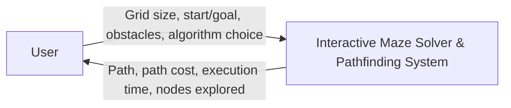
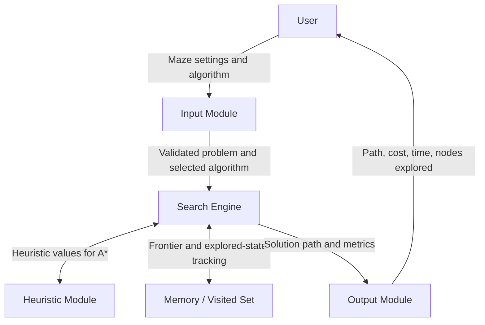
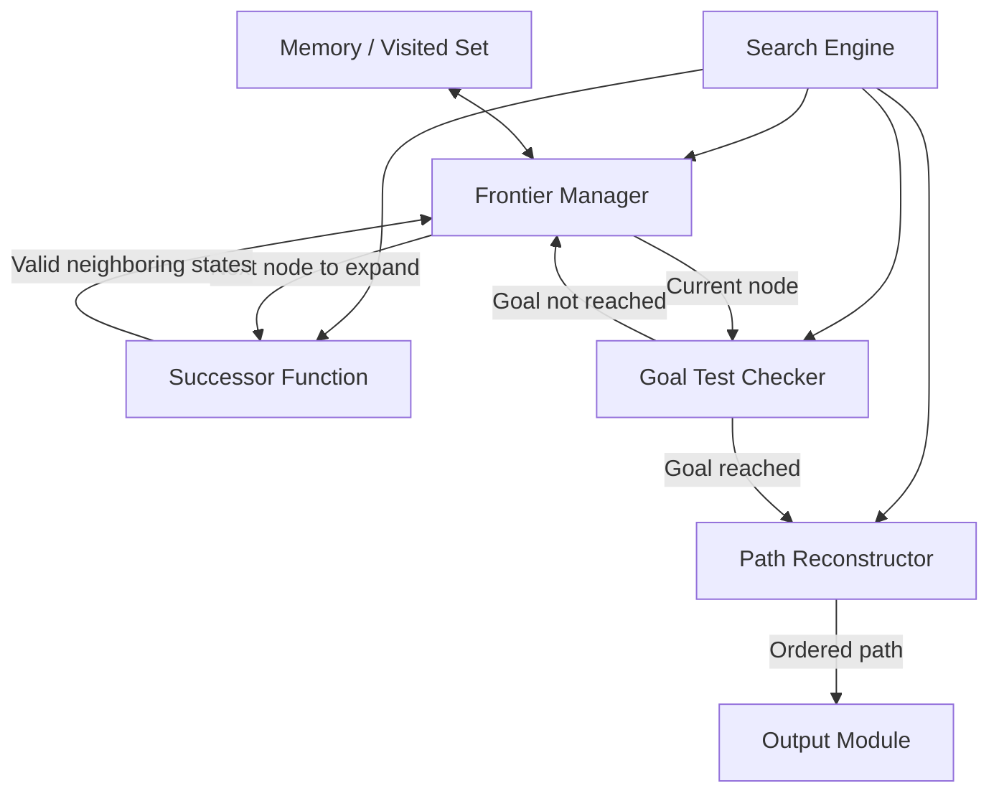
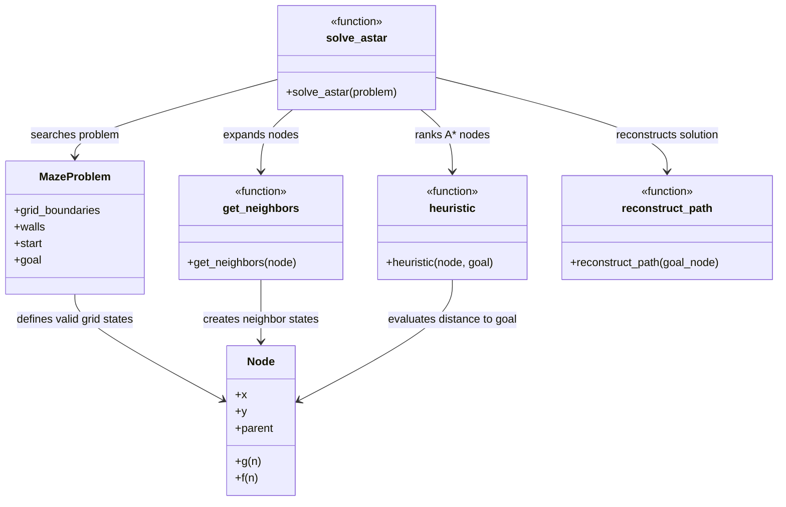

# SLE-3 C4 Architecture — Interactive Maze Solver & Pathfinding System

**Student:** Krisha Champalal Shaha  
**PRN:** 25UAM070  
**Division:** A  
**Course:** 02AML204 – Introduction to Artificial Intelligence  
**Related repository:** [IAI_SLE3](https://github.com/krishashaha19/IAI_SLE3)

This document records all four C4 levels from the SLE-3 architecture: Context, Container, Component, and Code. The diagrams use Mermaid, which GitHub can render directly.

## System description

The Interactive Maze Solver takes a grid, start and goal coordinates, obstacles, and a selected algorithm. It supports BFS, DFS, and A* search and returns a path plus metrics such as path cost, execution time, and nodes explored.

## Level 1 — System Context

**Purpose:** Show the system boundary and the external user.

**Explanation:** The user provides the maze configuration and chooses a search algorithm. The system searches the maze and returns the resulting path and performance information.

## Level 2 — Container Diagram

**Purpose:** Show the main parts inside the system and how data moves between them.

**Container responsibilities**
- **Input Module:** Reads grid dimensions, obstacle layout, start/goal coordinates, and algorithm choice.
- **Search Engine:** Runs BFS, DFS, or A*.
- **Heuristic Module:** Calculates heuristic values such as Manhattan distance for A*.
- **Memory / Visited Set:** Tracks frontier/explored states to avoid duplicate work and cycles.
- **Output Module:** Displays the path and metrics.

## Level 3 — Component Diagram

**Focused container:** Search Engine.

**Purpose:** Show the main internal components responsible for searching.

**Component responsibilities**
- **Frontier Manager:** Selects the next node to expand: FIFO queue for BFS, LIFO stack for DFS, or priority queue for A*.
- **Successor Function:** Generates valid neighboring grid positions (up, down, left, right).
- **Goal Test Checker:** Checks whether the current node is the goal.
- **Path Reconstructor:** Follows parent pointers backward and builds the ordered path.
- **Memory / Visited Set:** Helps the search track discovered/explored states.

## Level 4 — Code Diagram

**Purpose:** Map the design to the classes and functions identified in the SLE-3 report.

**Code-level summary**
- **Node:** Stores coordinates `(x, y)`, parent reference, path cost `g(n)`, and evaluation value `f(n)`.
- **MazeProblem:** Stores grid boundaries, wall coordinates, start state, and goal state.
- **get_neighbors(node):** Produces valid neighboring positions.
- **heuristic(node, goal):** Uses Manhattan distance, `|x1 - x2| + |y1 - y2|`, for A*.
- **solve_astar(problem):** Runs A* using a priority queue (the SLE-3 report identifies Python `heapq`).
- **reconstruct_path(goal_node):** Follows parent references to return the ordered path.

## How the four levels connect

| C4 level | Main question answered | In this project |
|---|---|---|
| Level 1 — Context | Who uses the system and what does it do? | User ↔ Maze Solver |
| Level 2 — Container | What major parts make up the system? | Input, Search, Heuristic, Memory, Output |
| Level 3 — Component | What are the internal parts of the Search Engine? | Frontier, Successor, Goal Test, Path Reconstructor |
| Level 4 — Code | Which classes/functions implement the design? | Node, MazeProblem, get_neighbors, heuristic, solve_astar, reconstruct_path |

**Accuracy note:** These diagrams express the architecture documented in the SLE-3 report. Check the labels against the actual source code before presenting them as a precise implementation diagram.
